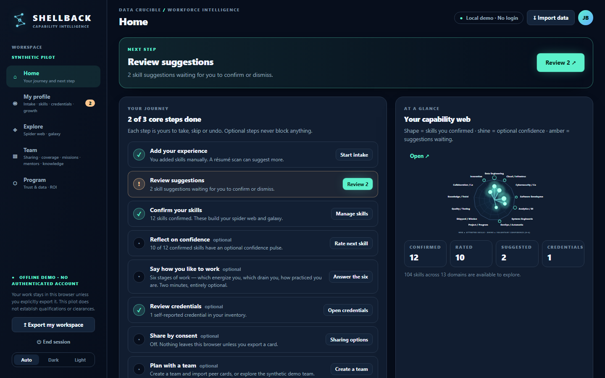
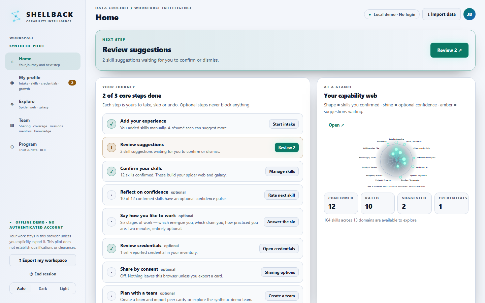

<p align="center"></p>

# Shellback

Workforce capability intelligence: employee-attested skills, kept separate from claims, in a local-first browser app.

## The name

A *shellback* is a sailor who has actually crossed the equator — a status you earn, not claim. Shellback keeps claimed skills separate from confirmed ones. Formerly Synapse.

Shellback is an employee-centered capability discovery and development prototype. It keeps résumé claims, confirmed skills, task-level confidence, execution mode, voluntary activity and self-entered credentials **separate**. It never creates a hidden proficiency rating.

This version is a full rebuild on the project's [TechStack](TechStack): React 19 + TypeScript, Tailwind CSS 4, IndexedDB storage, a Web Worker for résumé scanning, a service worker for offline caching, Web Crypto export encryption, and a PowerShell 5.1 loopback server. It is compiled off the workstation and shipped as plain JS/CSS. See [docs/ARCHITECTURE.md](docs/ARCHITECTURE.md) for the design and for the places where this build differs from the TechStack table.

| Night watch (dark) | Chart room (light) |
| --- | --- |
|  |  |

Home with the fictional employee Jordan Brooks loaded from the built-in examples (`node tools/screenshots.mjs` regenerates both pictures with mock data only).

## Run it (workstation: no install, no admin)

| Option | How | Notes |
| --- | --- | --- |
| **Served (recommended)** | Double-click `Launch-Shellback.bat` | Runs `powershell.exe -File tools\Start-Shellback.ps1`, which serves `dist\` on `http://127.0.0.1:8765/` and opens your browser. The port stays fixed because browser data is stored per origin. Loopback only. Stops by itself when you close the tab; **End session** in the navigation, Ctrl+C, or `tools\Stop-Shellback.ps1` stop it at once. Enables offline caching through the service worker. |
| **Single file** | Double-click `dist\Shellback-Standalone.html` | Everything is inlined in one file and runs from `file://`. No server and no service worker. Same features otherwise. |

Both editions store data only in the current browser profile (IndexedDB) and make **no network requests**. A Content-Security-Policy blocks any connection other than the page's own origin.

If you used the earlier MVP in the same browser, your `synapse-mvp-v1` data is detected and upgraded automatically, and the original copy is left untouched. Old JSON exports and peer cards still import.

## Build it (off-workstation)

Requires Node 22+. Run these on a build machine, not the target workstation:

```shell
npm install          # build/test dependencies
npm run build        # → dist/ (served edition, standalone file, service worker, build manifest)
npm test             # strict core typecheck, unit tests, dist freshness check, browser smoke tests
npm run serve        # optional: Node loopback server with the same headers as the PowerShell one
```

`dist/` is committed so the workstation never needs Node. CI runs on the self-hosted Windows runner. It rebuilds on every PR, runs the browser tests, starts the real `Start-Shellback.ps1` under Windows PowerShell 5.1, and **fails if the committed `dist/` doesn't match a fresh build** (`npm run build:check`; `.gitattributes` keeps line endings identical on Windows), so the shipped files always come from the reviewed source.

## How it's organised

Five destinations, following the employee journey from the product audit:

| Destination | What's there |
| --- | --- |
| **Home** | Your journey checklist with one *next step*, plus a glance at your web. |
| **My profile** | 1 Intake (scan a résumé, confirm or dismiss suggestions) · 2 Skills (confirmed list, consent switch) · 3 Credentials (review, inventory) · 4 Growth (study guides, goals, renewals). |
| **Explore** | Spider web and galaxy. Click any skill to confirm, dismiss, add or rate it in place. |
| **Team** | Roster & sharing · Coverage · Missions · Mentors · Knowledge, all over consented cards. |
| **Program** | Trust & data (storage, recovery, reset) · Intelligence (where suggestions come from) · ROI laboratory. |

The confidence pulse is a side drawer that opens from any skill, anywhere.

## Features

- **Taxonomy:** 13 capability domains and 104 task-oriented skills.
- **Résumé intake:** paste, or upload `.txt`, `.docx` or `.pdf` (text layer) — read in the browser, no library. Scanned in a Web Worker. Suggestions can be confirmed or dismissed; dismissed ones never come back on later scans. Skill suggestions skip negated phrases ("no Git experience"). Credential suggestions skip pursued or in-progress items ("Pursuing CISSP", "CISSP (in progress)"), and ambiguous acronyms (CISA, CSM, PSM, CKA) need certification context. Résumé text is never stored.
- **Attested-capability spider web:** confirming a skill adds it to the web, and optional 0–4 confidence only changes its glow. Labels work with the keyboard.
- **Skills galaxy (v2):** a deterministic d3-force map that never drifts. *Confirmed Skills* shows exactly your attestations; *Pathways* shows all 104 skills with learning links; *Show nearby pathways* (off by default) adds faint one-hop neighbours. Wheel to zoom, drag space to pan, **Fit**, hover to inspect, click or Enter to select, hold and drag a star to rearrange, arrow keys to move between stars.
- **Confidence pulse:** a side drawer, opened from any skill. Only attested skills can be rated, and a rating stays hidden in every view (including Pathways) once the skill is withdrawn.
- **Credential desk:** review, edit and approve résumé suggestions; edit in place; issue and renewal dates; provenance (*claimed* / *reviewed* / *verified by …*) with status derived from dates, never from a judgement; duplicates prevented; dismissals persist.
- **Draft teammates:** Team → Roster can build a teammate's card from a résumé you hold. Drafts are badged *not attested*, excluded from coverage unless you include them, and downloadable for the person to import as suggestions and confirm.
- **Teams & sharing:** local teams and opt-in JSON peer cards. Confidence, mentoring and credential names are each a separate opt-in. Re-importing a card with an existing id warns that it replaces that person's card. Aggregates appear only for 3+ people.
- **Local consent is granular:** the "contribute to team coverage" switch shares **confirmed skills only** with this browser's team tools. Mentoring details and credential names join only through their own checkboxes.
- **FLEETHACKER workflows** live where they belong: study guides, goals and renewals under My profile → Growth; missions, mentors and knowledge relay under Team. One implementation each, on a shared analytics module.
- **ROI laboratory:** cash and recovered capacity are reported separately, with adoption sensitivity.
- **How I like to contribute (two axes):** six stages of work (asking the big questions → finishing and pushing through). For each, how it affects your *energy* (5-point) and, optionally, how *practiced* you are (4-point). Together they separate **Flow** (energized + practiced), **Growth edge** (energized, learning), **Grind** (practiced, drained — the burnout watch) and **Avoid / pair**. Optional context tags ("under deadline", "in a small team"…) and a one-line example. No fixed number of each, no letters, no totals. Shellback's own wording, not an assessment. Import a results file (CSV `stage,energy` or JSON, plain-English synonyms accepted). Teams see energy by stage, pairing ideas and a printable workshop sheet; missions can ask for a stage and surface people energized by it.
- **Intelligence (configurable):** Local rules by default (nothing leaves the workstation). An authorized remote provider can be configured under Program → Intelligence (endpoint, encrypted bearer token, connection test). The page lists exactly what each task sends; the shipped CSP blocks every host unless the build allows it (`SHELLBACK_INTEL_HOST`). Contract and a loopback adapter for OpenAI-compatible gateways in `docs/INTELLIGENCE_PROVIDERS.md`. Sample fictional résumés for trying intake: `examples/resumes/` (PDF).
- **Supervisor brief:** Team → Coverage writes a plain-language summary from aggregate numbers only (shown before generation). Never names, ranks or scores a person.
- **Themes & print:** Auto / dark / light; printable capability summary (Profile → Skills) and team workshop sheet.
- **Organization codes:** enter your code (e.g. `9911.1`) and Shellback derives the department → division → branch → section tree by prefix and rolls coverage up through it. Nothing is shared without its own opt-in.
- **Encrypted exports (optional):** workspace backups and peer cards can be passphrase-protected with AES-256-GCM (PBKDF2-SHA-256, 310k iterations).
- **No silent data loss:** stored data that fails validation is moved to a recovery area you can download from (Trust & governance → Recovery). Imports skip malformed records, list them as warnings, and keep everything else.

## Privacy and data semantics

This is a synthetic demonstration. **Do not enter real personnel records, qualification data, sensitive details, clearance information, or actual résumé PII into this pilot on a shared or unapproved workstation.** Browser storage is not a secure multi-user data store, and the navigation is not an authorization boundary. There is no login; *Local demo · No login* is shown at all times.

Shellback is **not** an authoritative readiness, competency, credential, personnel or performance system. It does not crawl activity, ingest email or code, track employees, or infer skill decay. Missing data means **unknown**, not low proficiency.

For production: sponsor, employee/labor and privacy consultation; purpose limits and retention; ATO where required; identity federation, RBAC/ABAC and consent enforcement **server-side**; encrypted managed storage; auditable corrections, exports and deletions; minimum-size aggregation; and trust metrics. See [the product audit](docs/PRODUCT_AUDIT_2026-10-22.md).

## Data model (workspace v2)

Stored in IndexedDB (`synapse` → `workspace` → `current`); UI settings in `localStorage['synapse-settings-v3']`. Exports use the same shape. These storage names predate the rename to Shellback and are kept on purpose: they are where existing users' data lives in the browser.

```jsonc
{
  "schemaVersion": 2,
  "profile":   { "confirmed": [], "surveys": {}, "credentials": [], "candidates": [], "candidateDismissed": [], "lastScan": "",
                 "credentialCandidates": [], "credentialDismissed": [], "consent": false,
                 "shareMentoringLocally": false, "shareCredentialsLocally": false,
                 "displayName": "", "demoPersona": "", "shareId": "" },
  "teams":     { "active": "", "items": [ { "id", "name", "members": [], "priorities": [] } ] },
  "fleetPlans": { "<teamId>": { "mission": [], "selected": [] } },
  "workforce": { "modules": [], "attempts": [], "goals": [], "mentorship": {}, "knowledge": [], "mission": {} },
  "roi":       { "employees": 100, "...": "..." },
  "meta":      { "created": "YYYY-MM-DD", "updated": "YYYY-MM-DD" }
}
```

The schema is defined once with zod in `src/core/schema.ts`; it handles validation, clamping, v1→v2 migration and tolerant import. Peer cards keep the `synapse-peer-card` v1 wire format. Encrypted files use the `synapse-encrypted` v1 envelope. These format identifiers (also `synapse-draft-card`, `synapse-knowledge-relay`) predate the rename and are kept so that existing files, and copies of the app not yet updated, keep reading each other's exports.

## ROI calculation

Four benefit lanes and two cost lanes (`src/core/roi.ts`), each **cash** (money that stops leaving) or **capacity** (hours at the loaded rate, never counted as money):

| Lane | Kind | Formula |
|---|---|---|
| Outside expertise avoided | cash | external hours × share now answered internally × external rate — minus the internal experts' answering time as capacity *spent* |
| Duplicate training not bought | cash + capacity | people × training $ × avoidable share; people × training hours × avoidable share × rate |
| Credential lapses avoided | cash | lapses × cost per lapse × avoided share |
| Finding who knows what | capacity | leads × minutes/week × weeks × usable share × rate |
| Platform cost | cash cost | as entered |
| Profile upkeep, program admin | capacity spent | people × minutes/quarter × 4 × rate; admin hours × rate |

Adoption scales every people-driven lane; **break-even adoption** is solved directly (cash is linear in adoption). Each input is tagged *assumed / benchmark / measured* and the page reports what share of the result rests on assumptions. Defaults are deliberately conservative: at 60% adoption of a 100-person pilot the base case is roughly break-even, and net capacity is negative until measured figures replace the guesses. A printable assumptions sheet is one click away.

## Repository layout

```
src/core/       pure TypeScript domain logic (taxonomy, schema, scanners, analytics, ROI, crypto, sharing)
src/storage/    IndexedDB persistence, settings, scan-worker client
src/workers/    résumé scan Web Worker
src/app/        React UI: state store + actions, UI kit, visualizations, nine views
src/styles/     Tailwind 4 theme and visualization styles
public/         HTML template and service worker template
tools/          build.mjs, run-tests.mjs, serve.mjs, screenshots.mjs, Start-Shellback.ps1, Stop-Shellback.ps1, Shellback-Process.ps1
tests/unit/     node:test suites for core logic and actions
tests/e2e/      Playwright smoke tests against the compiled served and standalone editions
examples/       fictional employee workspaces and peer cards (also bundled as in-app personas)
assets/brand/   emblem (dark and light); not yet wired into the app UI
dist/           compiled, committed output shipped to workstations
docs/screenshots/ README screenshots (tools/screenshots.mjs)
```

License: prototype source provided as-is for evaluation. Third-party code is bundled into `dist/` under each package's license (React, d3, zod, clsx, class-variance-authority, tailwind-merge, Tailwind CSS: all MIT or ISC).
