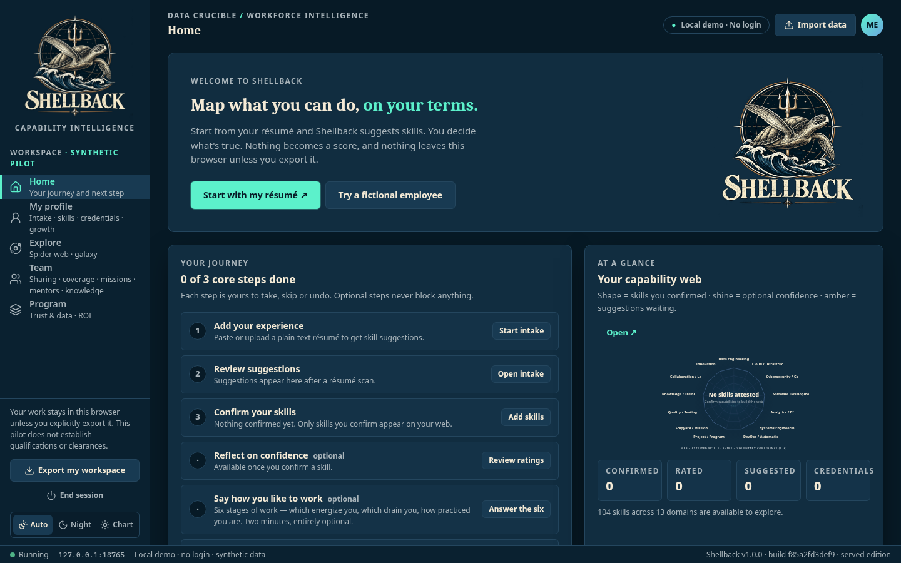
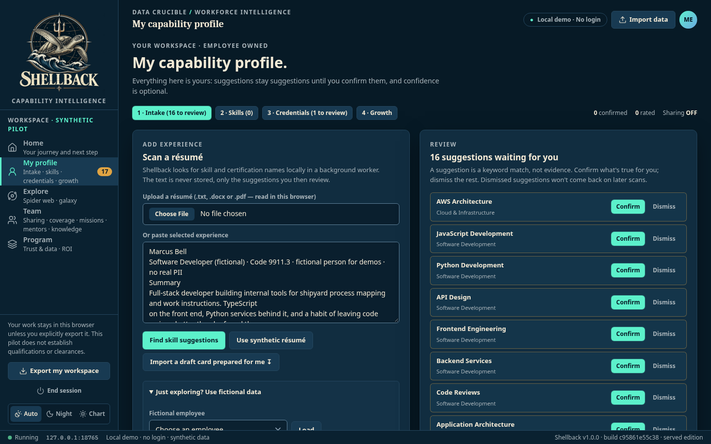
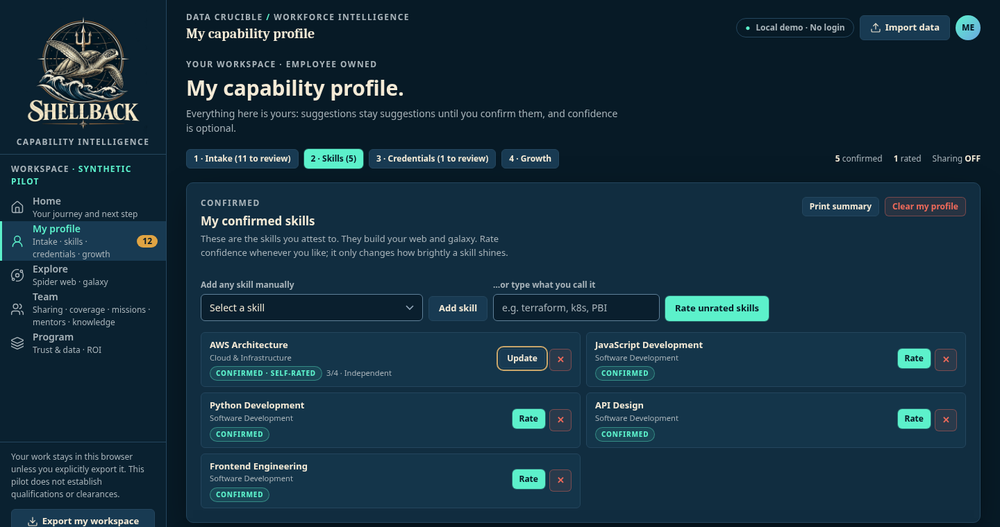
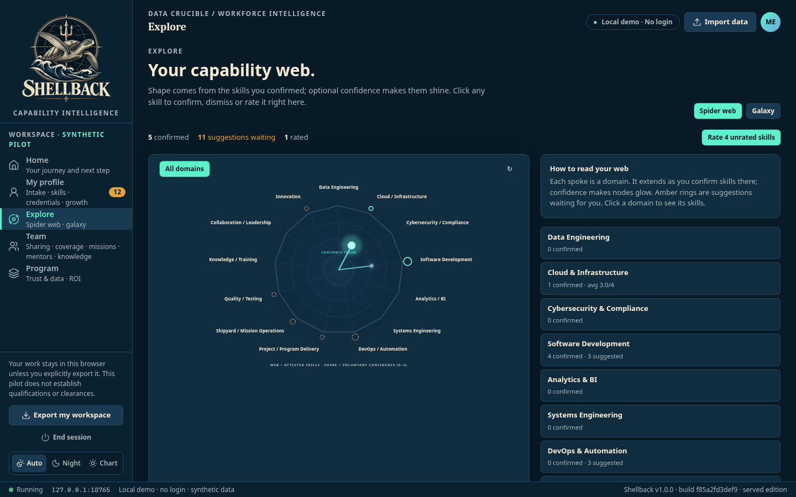
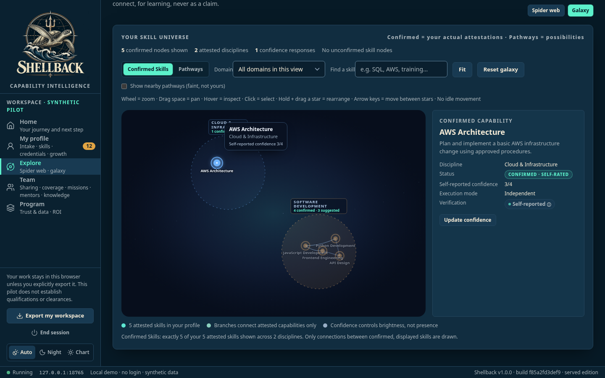
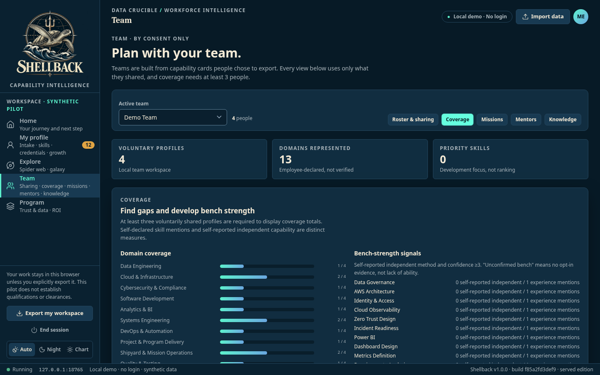
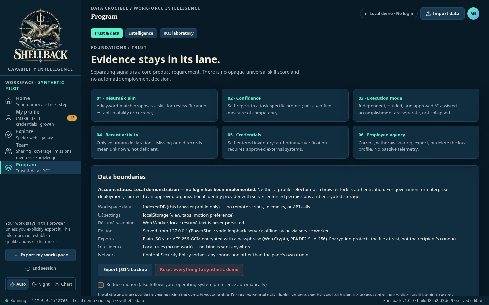

# Shellback walkthrough

Record the skills you can attest to, see them on a map, and share only what you choose with your team.

> **Screenshots:** captured with demo data and scanned by the Chief of Staff (team directive 10). Steps marked *Screenshot pending* still need a new capture; their image links do not resolve yet.

## Before you start

- Windows PowerShell 5.1 (part of Windows). No administrator rights and no installer.
- Microsoft Edge or Google Chrome.
- Launch: Double-click `Launch-Shellback.bat` (serves `dist\` on `http://127.0.0.1:8765/`).
- Synthetic data only: never real personnel records or résumé PII.

## Steps

### 1. First launch

Shellback opens on **Home** with your next step. *Local demo · No login* is always shown.

### 2. Scan a résumé

In **My profile**, paste or upload a résumé. Shellback suggests skills and credentials, and never stores the résumé text.

*Screenshot pending: a new capture is needed for this step.*

### 3. Confirm your skills

Confirm or dismiss each suggestion, and optionally add a 0 to 4 confidence rating.

*Screenshot pending: a new capture is needed for this step.*

### 4. Explore the spider web

**Explore** shows your confirmed skills across the 13 capability domains.

### 5. Explore the galaxy

Switch to the skills galaxy. Zoom, pan and select a star to inspect it.

### 6. See team coverage

In **Team**, import peer cards, choose the active team and open the **Coverage** tab. Coverage shows aggregates only, and only for 3 or more people.

### 7. Check trust and data

**Program** opens on **Trust & data**: how each kind of evidence is kept separate, and the data boundaries of this local demo, including what is stored in the browser and how exports work.

## About these images

Images live in [`docs/assets/walkthrough/`](../assets/walkthrough/), named `NN-<screen>.png` after the step they belong to. They are 1440x900 at 100% scale in the dark (Auto theme on a dark system) theme, and show demo data only.
